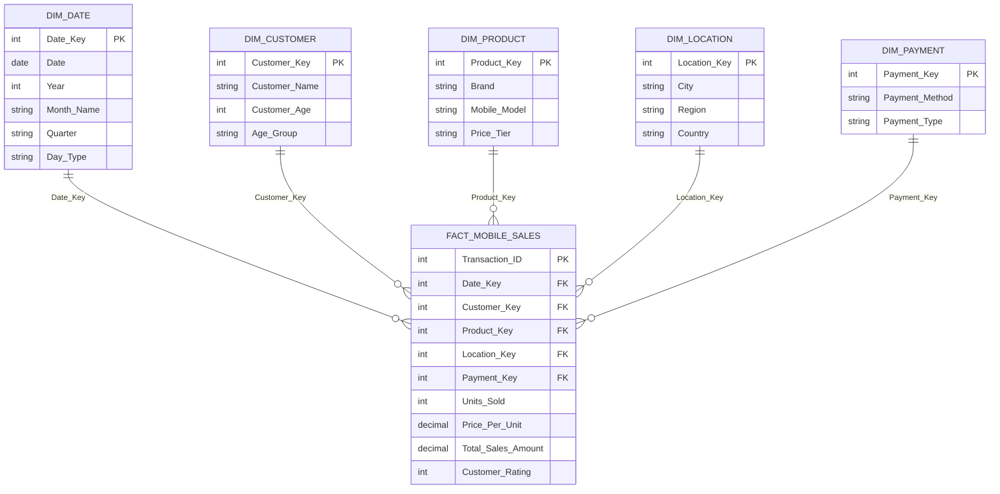

# 📱 Mobile Device & Telecom Retail Analytics Dashboard
### *Dual-Architecture Analytics: The Standalone HTML Way vs. The Modular Streamlit Way*

[](https://www.python.org/)
[](https://streamlit.io/)
[](https://developer.mozilla.org/en-US/docs/Web/HTML)
[](#-data-model--star-schema)
[](#)
[](#)

---

## 📌 Executive Overview

This repository presents an **end-to-end retail business intelligence project** analyzing nationwide mobile device transactions. It demonstrates two fundamentally different architectural philosophies for delivering modern data analytics to stakeholders:

1. **The HTML Way (`THE HTML WAY/`)**: A zero-dependency, self-contained single-file compiler architecture. All cleaned data, dark-mode CSS glassmorphism, and client-side charting logic are pre-baked into a single standalone `.html` file that runs instantly in any web browser without Python, node, or web servers.
2. **The Streamlit Way (`THE STREAMLIT WAY/`)**: An enterprise modular data engineering and web app pipeline. Features automated ETL cleansing, Kimball Star Schema dimensional modeling (Fact and Dimension tables), vectorized NumPy DAX metric calculations, and a real-time reactive Streamlit dashboard (`localhost:8501`).

Accompanying the implementation is an executive whitepaper: **[`HTML_WAY_VS_STREAMLIT_WAY_ARCHITECTURAL_SHOWDOWN.pdf`](./HTML_WAY_VS_STREAMLIT_WAY_ARCHITECTURAL_SHOWDOWN.pdf)**.

---

## 📂 Project Structure

```text
02. MOBILE SALES PROJECT/
├── HTML_WAY_VS_STREAMLIT_WAY_ARCHITECTURAL_SHOWDOWN.pdf   # Architectural comparison paper
├── README.md                                             # Master project documentation
├── requirements.txt                                      # Root environment dependencies
├── .gitignore                                            # Git ignore rules
│
├── THE HTML WAY/                                         # ARCHITECTURE 1: OFFLINE SINGLE-FILE
│   ├── 1. Cleaned_Mobile_Sales.csv                       # Clean input dataset
│   ├── 2. Mobile_Sales_Dashboard.html                    # 100% offline standalone dashboard (2.4 MB)
│   ├── 3. generate_offline_dashboard.py                  # HTML compiler & data serializer script
│   ├── 4. charts/                                        # Generated analytical visual charts
│   ├── 5. requirements.txt                               # HTML compiler requirements
│   └── 6. ARCHITECTURAL_BLUEPRINT_HTML_WAY.md            # Technical architectural dossier
│
└── THE STREAMLIT WAY/                                    # ARCHITECTURE 2: MODULAR DATA PIPELINE
    ├── 1. Raw_Mobile_Sales.csv                           # Raw transactional sales records
    ├── 2. clean_data.py                                  # Automated cleansing and validation script
    ├── 3. Cleaned_Mobile_Sales.csv                       # Master cleaned dataset
    ├── 4. build_star_schema.py                           # Kimball dimensional modeling engine
    ├── 5. Dim_Customer.csv                               # Dimension: Customer profiles & age cohorts
    ├── 5. Dim_Date.csv                                   # Dimension: Calendar & date hierarchies
    ├── 5. Dim_Location.csv                               # Dimension: Cities, regions & territories
    ├── 5. Dim_Payment.csv                                # Dimension: Payment methods & channels
    ├── 5. Dim_Product.csv                                # Dimension: Brands, models & price tiers
    ├── 5. Fact_Mobile_Sales.csv                          # Fact Table: Grain-level sales transactions
    ├── 5. Mobile_Sales_Summary.json                      # Aggregated metric cache
    ├── 6. dax_numpy_metrics.py                           # Vectorized DAX-equivalent KPI engine
    ├── 7. DAX_Formulas_and_Model.md                      # DAX formulas, measures & schema docs
    ├── 8. generate_matplotlib_charts.py                  # Matplotlib visual generation script
    ├── 9. app.py                                         # Streamlit analytical dashboard application
    ├── 10. ARCHITECTURAL_BLUEPRINT_STREAMLIT_WAY.md      # Streamlit pipeline technical dossier
    └── requirements.txt                                  # Streamlit environment dependencies
```

---

## 🏛️ Architecture Breakdown

### 1. The Offline Standalone HTML Way
Designed for **instant stakeholder distribution, zero-friction review, and security-restricted environments** (air-gapped networks, corporate email, mobile devices):
- **Zero Installation:** No Python runtime, virtualenv, or terminal required.
- **Single-File Inlined Data:** `2. Mobile_Sales_Dashboard.html` bundles the entire 3,800+ row dataset as embedded JSON.
- **Client-Side Rendering:** Powered by vanilla HTML5, Canvas charts, and custom glassmorphic CSS.
- **Sub-50ms Response Time:** Slicers, KPI filters, and search queries render at native browser speed.

### 2. The Modular Streamlit Pipeline Way
Designed for **enterprise data warehouses, live data refresh cycles, and deep exploratory analytics**:
- **Kimball Star Schema:** Transactional logs decomposed into normalized dimensions (`Dim_Customer`, `Dim_Date`, `Dim_Location`, `Dim_Payment`, `Dim_Product`) and a central `Fact_Mobile_Sales` table.
- **Vectorized KPI Math:** High-performance DAX-equivalent measures calculated with NumPy vectors.
- **Interactive UI (`9. app.py`):** Dynamic sidebar filtering by brand and price tier, metric cards, Matplotlib distribution histograms, and live filtered data grids.

---

## 📊 Data Model & Star Schema

The modular pipeline organizes transaction logs into an analytical **Kimball Star Schema**:



---

## ⚡ Quickstart Guide

### Prerequisites
- Python 3.9+ (only required for running the Python compiler or Streamlit application)
- Modern web browser (Chrome, Edge, Firefox, Safari)

### Option A: Launching The HTML Dashboard (Instant)
1. Navigate to `THE HTML WAY/`
2. Double-click **`2. Mobile_Sales_Dashboard.html`** or open with any browser.
3. *That's it! Full interactive experience with 0 dependencies.*

---

### Option B: Running The Streamlit Dashboard

1. **Clone the repository:**
   ```bash
   git clone https://github.com/Muntasib-2006/02.-mobile-sales-project.git
   cd "02.-mobile-sales-project"
   ```

2. **Set up a virtual environment (recommended):**
   ```bash
   python -m venv .venv
   # Windows:
   .venv\Scripts\activate
   # macOS / Linux:
   source .venv/bin/activate
   ```

3. **Install dependencies:**
   ```bash
   pip install -r requirements.txt
   ```

4. **Launch the Streamlit app:**
   ```bash
   streamlit run "THE STREAMLIT WAY/9. app.py"
   ```
   Open your browser at `http://localhost:8501`.

---

## 🔄 Re-running the Data Pipelines

To execute the pipelines from scratch:

```bash
# 1. Clean the raw data
python "THE STREAMLIT WAY/2. clean_data.py"

# 2. Build the Star Schema Fact & Dimension tables
python "THE STREAMLIT WAY/4. build_star_schema.py"

# 3. Calculate DAX / NumPy KPIs
python "THE STREAMLIT WAY/6. dax_numpy_metrics.py"

# 4. (Optional) Recompile the offline standalone HTML dashboard
python "THE HTML WAY/3. generate_offline_dashboard.py"
```

---

## ⚔️ Architectural Comparison Matrix

| Dimension | The HTML Way | The Streamlit Way |
| :--- | :--- | :--- |
| **Execution Environment** | Client Browser (`file:///`) | Web Server (`localhost:8501`) |
| **Dependencies** | **Zero** (Vanilla HTML5 / JS / Canvas) | Python, Streamlit, Pandas, NumPy |
| **Portability** | 🟢 **100% Portable** (Single 2.4 MB file) | 🟡 Requires server or container hosting |
| **Latency** | ⚡ **<50ms** client-side computation | 🔄 Server round-trip / reactive rerun |
| **Data Modeling** | Inlined Denormalized JSON | Normalized Kimball Star Schema |
| **Best Used For** | Executive decks, email distribution, field sales | Data teams, live warehouse queries, ML pipelines |

*For complete benchmarks, memory profiling, and trade-offs, read [`HTML_WAY_VS_STREAMLIT_WAY_ARCHITECTURAL_SHOWDOWN.pdf`](./HTML_WAY_VS_STREAMLIT_WAY_ARCHITECTURAL_SHOWDOWN.pdf).*

---

## 📄 License & Attribution

Developed as a showcase for modern Data Analytics, Dimensional Modeling, and Dashboard Architecture. Open-sourced under the MIT License.
