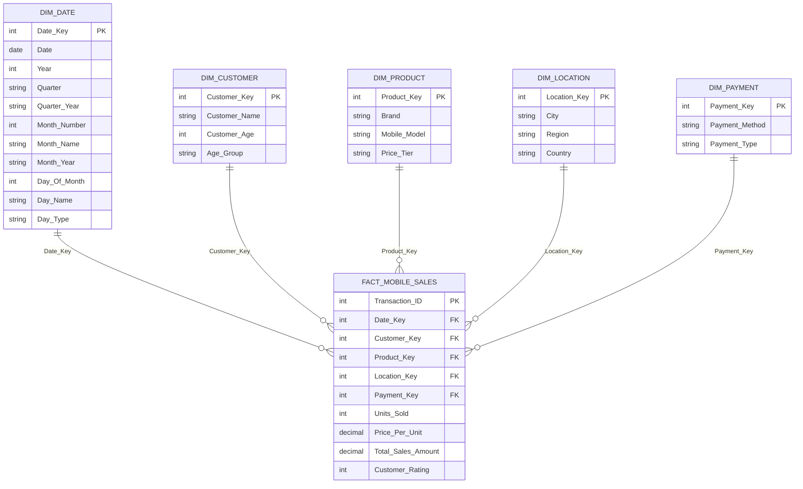

# Mobile Sales Intelligence & Analytics System
## Star Schema Architecture & DAX Formulas Blueprint

---

### **1. Data Model Architecture (Star Schema)**



---

### **2. DAX Formula Catalog**

#### **Category 1: Core Revenue & Volume Measures**
1. **Total Sales Revenue**:
   ```dax
   Total Revenue = SUM(Fact_Mobile_Sales[Total_Sales_Amount])
   ```

2. **Total Units Sold**:
   ```dax
   Total Units Sold = SUM(Fact_Mobile_Sales[Units_Sold])
   ```

3. **Total Transactions Count**:
   ```dax
   Total Transactions = COUNTROWS(Fact_Mobile_Sales)
   ```

4. **Average Order Value (AOV)**:
   ```dax
   Average Order Value = DIVIDE([Total Revenue], [Total Transactions], 0)
   ```

5. **Average Selling Price (ASP)**:
   ```dax
   Average Selling Price = DIVIDE([Total Revenue], [Total Units Sold], 0)
   ```

6. **Average Units per Order**:
   ```dax
   Avg Units Per Order = DIVIDE([Total Units Sold], [Total Transactions], 0)
   ```

---

#### **Category 2: Brand & Product Intelligence**
7. **Brand Revenue Share %**:
   ```dax
   Brand Revenue Share % = 
   DIVIDE(
       [Total Revenue],
       CALCULATE([Total Revenue], ALL(Dim_Product[Brand])),
       0
   )
   ```

8. **Brand Volume Share %**:
   ```dax
   Brand Volume Share % = 
   DIVIDE(
       [Total Units Sold],
       CALCULATE([Total Units Sold], ALL(Dim_Product[Brand])),
       0
   )
   ```

9. **Top Selling Brand by Revenue**:
   ```dax
   Top Brand by Revenue = 
   TOPN(1, VALUES(Dim_Product[Brand]), [Total Revenue], DESC)
   ```

10. **Product Sales Rank**:
    ```dax
    Product Sales Rank = 
    RANKX(
        ALL(Dim_Product[Mobile_Model]),
        [Total Revenue],
        ,
        DESC,
        Dense
    )
    ```

---

#### **Category 3: Customer Demographics & Sentiment**
11. **Total Unique Customers**:
    ```dax
    Unique Customers = DISTINCTCOUNT(Fact_Mobile_Sales[Customer_Key])
    ```

12. **Average Customer Rating**:
    ```dax
    Average Customer Rating = AVERAGE(Fact_Mobile_Sales[Customer_Rating])
    ```

13. **High Rating Transactions (4-5 Stars) %**:
    ```dax
    High Rating Pct = 
    DIVIDE(
        CALCULATE([Total Transactions], Fact_Mobile_Sales[Customer_Rating] >= 4),
        [Total Transactions],
        0
    )
    ```

14. **Revenue by Age Group Share %**:
    ```dax
    Age Group Revenue Share % = 
    DIVIDE(
        [Total Revenue],
        CALCULATE([Total Revenue], ALL(Dim_Customer[Age_Group])),
        0
    )
    ```

---

#### **Category 4: Geographical & Regional Performance**
15. **City Revenue Share %**:
    ```dax
    City Revenue Share % = 
    DIVIDE(
        [Total Revenue],
        CALCULATE([Total Revenue], ALL(Dim_Location[City])),
        0
    )
    ```

16. **Top City by Sales**:
    ```dax
    Top City by Sales = 
    TOPN(1, VALUES(Dim_Location[City]), [Total Revenue], DESC)
    ```

17. **Regional Sales Contribution %**:
    ```dax
    Regional Sales Share % = 
    DIVIDE(
        [Total Revenue],
        CALCULATE([Total Revenue], ALL(Dim_Location[Region])),
        0
    )
    ```

---

#### **Category 5: Payment Method & Channel Distribution**
18. **Digital Payment Adoption %**:
    ```dax
    Digital Payment Share % = 
    DIVIDE(
        CALCULATE([Total Revenue], Dim_Payment[Payment_Type] = "Digital"),
        [Total Revenue],
        0
    )
    ```

19. **UPI Revenue Contribution**:
    ```dax
    UPI Revenue = 
    CALCULATE([Total Revenue], Dim_Payment[Payment_Method] = "UPI")
    ```

---

#### **Category 6: Time Intelligence & Growth Metrics**
20. **Month-over-Month (MoM) Revenue Growth %**:
    ```dax
    MoM Revenue Growth % = 
    VAR CurrentMonthSales = [Total Revenue]
    VAR PreviousMonthSales = CALCULATE([Total Revenue], DATEADD(Dim_Date[Date], -1, MONTH))
    RETURN
    DIVIDE(CurrentMonthSales - PreviousMonthSales, PreviousMonthSales, 0)
    ```

21. **Year-over-Year (YoY) Growth %**:
    ```dax
    YoY Revenue Growth % = 
    VAR CurrentYearSales = [Total Revenue]
    VAR PreviousYearSales = CALCULATE([Total Revenue], SAMEPERIODLASTYEAR(Dim_Date[Date]))
    RETURN
    DIVIDE(CurrentYearSales - PreviousYearSales, PreviousYearSales, 0)
    ```

22. **Year-to-Date (YTD) Revenue**:
    ```dax
    YTD Revenue = TOTALYTD([Total Revenue], Dim_Date[Date])
    ```